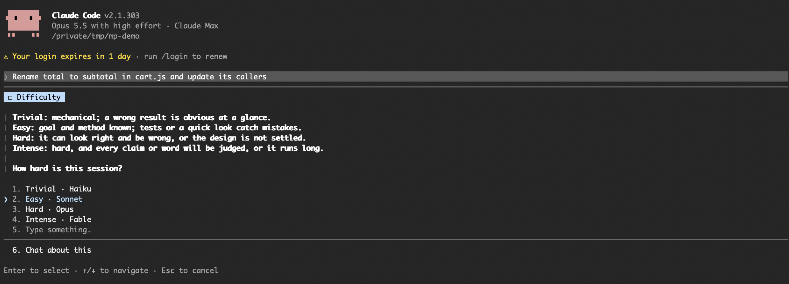
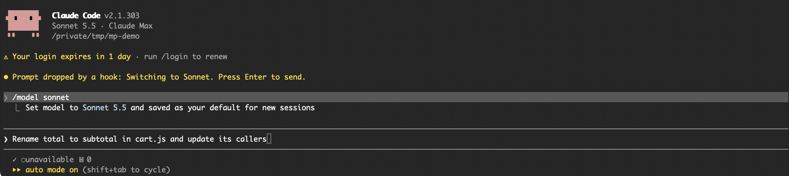

# model-picker

A Claude Code mod that asks how hard a new session is before its first prompt runs, then switches to the matching model.

Picking the model yourself takes one keypress, and it makes you think for a moment about the work before it starts. The mod keeps a local log of every answer, so you can later look back at what you picked and what each session cost.



## How it works

1. Start a new session and type your first prompt as usual.
2. Before the prompt is sent, the mod asks how hard the session is.
3. You pick a level. The mod switches to that model and puts your prompt back in the input box.
4. Press Enter to send it, now on the model you picked.



| Level | Model | When to pick it |
|---|---|---|
| Trivial | Haiku | Mechanical work; a wrong result is obvious at a glance. |
| Easy | Sonnet | Goal and method known; tests or a quick look catch mistakes. |
| Hard | Opus | It can look right and be wrong, or the design is not settled. |
| Intense | Fable | Hard, and every claim or word will be judged, or it runs long. |

Picking a level runs `/model`, which also saves that model as your default for new sessions. A session where you dismiss the menu, and any `claude -p` run, starts on the last model you picked.

The menu appears once per session, on the first prompt you type. It does not appear for:

- resumed sessions, which already have a model and a cache
- `claude -p` runs, messages from other agents and notifications

| What you do at the menu | What happens |
|---|---|
| Pick a level | The model switches and the prompt waits for Enter. If you are already on that model, the prompt is sent straight away. |
| Type an answer under Other | The answer is logged and the model stays as it is. The prompt is sent. |
| Dismiss the menu (Esc) | The skip is logged and the model stays as it is. The prompt is sent. |

## Install

In Claude Code:

```
/plugin marketplace add raam86/model-picker
/plugin install model-picker@model-picker
```

Or from a shell:

```sh
claude plugin marketplace add raam86/model-picker
claude plugin install model-picker@model-picker
```

The menu appears in the next new session.

It needs a Claude Code version with function hooks (mods). It was tested on Claude Code 2.1.303. The Intense level needs access to Fable. Without it, the switch fails, a status line says so, and the session stays on its current model.

## Instructions for Claude

This section is for Claude Code when a user asks it to install, use or change this mod.

**Installing.** Run these two commands with the Bash tool. Do not edit `settings.json` by hand.

```sh
claude plugin marketplace add raam86/model-picker
claude plugin install model-picker@model-picker
claude plugin list
```

`claude plugin list` must show `model-picker@model-picker` as enabled. Then tell the user that the menu appears from their next new session, not the current one, and that it appears once, on the first prompt they type.

**Using it.** The user answers the menu. Claude never answers it for them. If the user asks which level to pick, explain the four levels from the table above and let them decide.

**Reading the log.** Each session writes one JSON file to `~/.local/state/model-picker/<session-id>.json`. The fields are listed under [The log](#the-log). To summarise what a user picked, read these files. Each one holds a single JSON object.

**Changing the levels or models.** Edit `MODEL` and `QUESTION` at the top of `hooks/register.js`. The keys of `MODEL` are the menu labels, in the form `Level · Model`, and the values are what is passed to `/model`. Run `claude plugin validate .` after any change.

**Uninstalling.**

```sh
claude plugin uninstall model-picker@model-picker
claude plugin marketplace remove model-picker
```

## The log

Each session gets one file in `~/.local/state/model-picker/`, named after the session id. The log stays on your machine; the mod sends nothing anywhere.

| Field | What it holds |
|---|---|
| `sessionId`, `cwd` | The session and the folder it ran in |
| `askedAt`, `answeredAt`, `decisionMs` | When the menu appeared, when you answered, and how long you took |
| `modelBefore`, `model` | The model the session started on, which is your saved default and so usually your last pick, and the one you picked (`null` if skipped or typed under Other) |
| `answer`, `difficulty`, `skipped` | The label you picked or the text you typed, the level, and whether you dismissed the menu |
| `prompt`, `promptChars` | The **first 300 characters** of your first prompt, and its full length |
| `switchedAt`, `switchError` | When the model switch happened, or why it failed |
| `turns` | One entry per turn: when it ended, the session's model, the models that actually answered, the duration, and whether it was aborted |
| `endedAt`, `endReason`, `costUsd`, `contextTokens` | When and why the session ended, its cost and its context size |

The log keeps part of your first prompt. Delete the folder if you don't want that kept.

## License

MIT. See [LICENSE](LICENSE).
